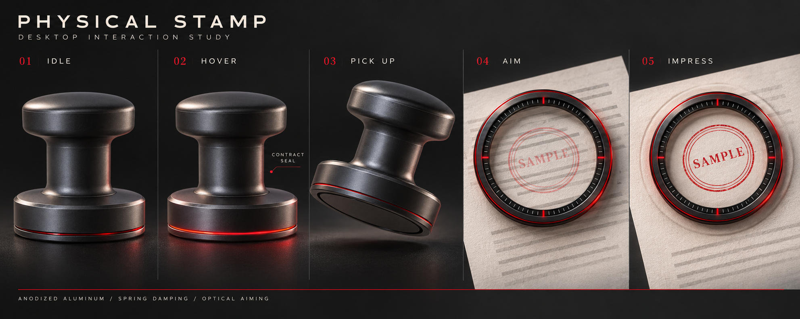

# mignet · 桌面实体印章

**把真实盖章的手感带进 Word：拿起、瞄准、落章，一次到位。**

mignet（程序名 `DesktopStamp`）是一个常驻 Windows 桌面的「实体印章」浮层。印章停在屏幕角落；拿起它，在 Word 文档上瞄准，点一下，印章就作为图片衬于文字下方插入文档，落点误差实测 0.26–0.94 mm。



- 官网：<https://mignet.mintryu.com/>
- 下载：[GitHub Releases](https://github.com/ysuhao/mignet/releases/latest) · [夸克网盘](https://pan.quark.cn/s/20b000d22f8a)
- 作者：[MINT RYU](https://mintryu.com/)

## 功能

- **拿起 · 瞄准 · 落章**：按住拖动拿起，松手进入瞄准，单击落章。落章后保持瞄准，可以边滚动文档边连续盖。
- **准**：按 Word 页面坐标定位，多显示器、不同缩放比例下落点误差 ≤ 1 mm，不会跑到下一页。
- **像真的**：衬于文字下方，黑字压在红章上；每次 ±1–3° 随机角度和随机墨迹纹理。
- **不打扰 Word**：浮层不抢焦点，普通滚轮和翻页键照常传给 Word；所有 Word COM 调用都在后台线程。
- **一步撤销**：每个章在 Word 里是普通对象，一次 Ctrl+Z 撤销整个章。
- **尺寸与角度**：Ctrl + 滚轮调尺寸（12–75 mm），Alt + 滚轮旋转（3°/格），也可锁定 20 / 40 mm。
- **导入自己的印章**：把 PNG / JPG / BMP / TIF 拖到印章上。透明 PNG 直接使用；扫描件和照片会自动提取红色印泥。

内置的三枚印章均为 **SAMPLE / 样章**，仅供演示。请只导入你有权使用的印章。

## 下载与运行

1. 从 [Releases](https://github.com/ysuhao/mignet/releases/latest) 或 [夸克网盘](https://pan.quark.cn/s/20b000d22f8a) 下载 `mignet-1.0.0-windows.zip`，完整解压。
2. 双击 `DesktopStamp.exe`。程序未做代码签名，SmartScreen 提示时选「更多信息 → 仍要运行」。
3. 需要 Windows 10 / 11、.NET Framework 4.7.2+（系统自带）和桌面版 Microsoft Word（页面视图）。

| 操作 | 输入 |
|---|---|
| 拿起 | 在停靠的印章上按住左键拖动 |
| 落章 | 瞄准模式下单击左键 |
| 滚动文档 | 普通滚轮 / PageUp / PageDown |
| 调整尺寸 | Ctrl + 滚轮 |
| 旋转 | Alt + 滚轮，或在外圈金属环上滚动 |
| 放回角落 | 右键 或 Esc |
| 菜单（切换印章、导入、锁定尺寸、退出） | 停靠时右键 |

## 从源码构建

需要 Visual Studio 2022 或更新版本的 MSBuild（.NET Framework 4.7.2 目标包）。

```powershell
powershell -ExecutionPolicy Bypass -File .\scripts\build.ps1   # 输出到 dist-v2\
powershell -ExecutionPolicy Bypass -File .\scripts\test.ps1    # 冒烟检查 + 23 组自动化测试
```

`scripts/export-previews.ps1` 用离屏渲染器导出各状态预览图到 `design/runtime-previews-v2/`；`benchmarks/` 是浮层与 Word 联动的性能基准。

## 目录结构

| 路径 | 内容 |
|---|---|
| `src/Core` | 状态机、弹簧阻尼、坐标换算 |
| `src/UI` | `UpdateLayeredWindow` 浮层、渲染器、毛玻璃菜单、鼠标钩子 |
| `src/HostAdapters` | Word COM / MSAA 集成、后台 STA 工作线程、点击快照校验；PDF / Excel 适配器为占位 |
| `src/Imaging` | 素材加载、印章图像处理（红色印泥提取、墨迹纹理） |
| `src/Audio` | 合成的落章音效 |
| `tests/` · `benchmarks/` · `tools/` | 测试、性能基准、Word 定位复现工具 |
| `docs/REQUIREMENTS-WORD-FIX.md` | v3 Word 落点修复的需求与验收标准 |

目前只支持 Microsoft Word。WPS、PDF、Excel 尚在规划中。

## 许可

Copyright (C) 2026 MINT RYU

本程序是自由软件：你可以依据自由软件基金会发布的 GNU 通用公共许可证第 3 版（GPLv3）重新发布和/或修改它。本程序的发布是希望它有用，但**不提供任何担保**。许可全文见 [LICENSE](LICENSE)。

---

## Technical reference (English)

### Interaction Contract & Controls

| Mode / Action | Input | Behavior |
|---|---|---|
| **Parked (Idle)** | Hover over stamp body | Breathes subtle crimson base seam glow and reveals active seal name + size in tiny sans-serif text. Settled Idle skips redundant `UpdateLayeredWindow` redraws (`0.0%` CPU). Transparent padding around the body is click-through. |
| **Pickup** | Left-drag from Idle | Immediate `0.97` tactile press compression on left-down, lifting with elapsed-time (`dt`) stable spring-damper lag, velocity-dependent tilt, and single-silhouette pose handoff from upright side view (`stamp-idle-v1.png`) through tilted view (`stamp-drag-v1.png`) to top-down precision reticle (`stamp-reticle-v1.png`). Late pickup (`MorphProgress >= 0.55`) enables `WS_EX_TRANSPARENT` and pre-warms background STA Word probing so entering Word never stalls on release. |
| **Aiming Mode** | Release Left Mouse Button | Stays suspended in aiming mode over the desktop/document without stealing focus from Microsoft Word (`WS_EX_NOACTIVATE` + dynamic `WS_EX_TRANSPARENT`), smoothly converging any remaining pickup morph without a 1-frame snap. |
| **Document Scroll / Navigation** | Plain Mouse Wheel or `PageUp`/`PageDown`/`Home`/`End`/Arrows | Passes straight through to the underlying Microsoft Word window **once and never twice** (`WS_EX_TRANSPARENT` + native `CallNextHookEx`), while advancing `ViewEpoch` to invalidate any pending click snapshot and trigger an immediate background re-probe. |
| **Physical Size Scale** | `Ctrl + Mouse Wheel` | Scales physical seal ink imprint size in millimeters (`12 mm` – `75 mm`, `1.5 mm` per 120-unit notch with high-resolution touchpad accumulation) when size lock is set to Free Scale. |
| **Rotate Seal** | `Alt + Mouse Wheel` or `Mouse Wheel` on outer metal ring | Rotates the seal (`3.0°` per 120-unit notch) while swallowing the wheel event so Word does not scroll. |
| **Commit Stamp** | Left Click in Aiming | Captures an immutable click snapshot at `LEFT DOWN` (`ScreenPoint`, `PhysicalSizeMm`, `TotalRotationDeg`, `ExpectedTargetHwnd`, `ExpectedRootHwnd`, `ClickViewEpoch`, `ClickCancelEpoch`), runs a fast Z-compression plunge and rebound (`220 ms`) with locked pre-impact coordinates, tight contact shadow, thin air shockwave ripple, synthesized mechanical click + low-frequency paper impact thud, and **signed $\pm(1^\circ \text{ to } 3^\circ)$ random angular jitter**. Automatically remains in **Aiming mode** after each stamp for repeated scroll/stamp work. |
| **Return to Dock** | Right Click in Aiming or `Esc` | Advances `CancelEpoch` (aborting any in-flight/pending stamp snapshot) and travels along a responsive cubic ease-out elevated quadratic Bézier arc back to the parked corner position (`StampStateMachine.BeginPickupDrag` supports mid-return re-pickup at the state-machine API level; the live overlay keeps `WS_EX_TRANSPARENT` active during `Returning` so physical desktop clicks pass through until parked). |
| **Frosted Context Menu** | Right Click in Idle | Opens a DPI-scaled minimal dark frosted menu with full keyboard navigation (`Up`/`Down`/`Tab`/`Home`/`End`/`Enter`/`Space`/`Escape`): active seal switching (3 built-in `SAMPLE / 样章` demonstration seals + imported seals), image import fallback dialog, `20mm` / `40mm` physical size locks, free scaling mode, angle reset, and **Exit Stamp**. |
| **Seal Drag-and-Drop** | Drag `.png` / `.jpg` / `.bmp` / `.tif` onto Idle stamp | Brief vertical bounce and crimson flash; loads the seal into memory without overwriting the source file. Preserves valid alpha channels; extracts red seal ink from opaque photos/scans via chromatic redness thresholding and smoothstep antialiasing. Reports unsupported files clearly. |

---

### Honest Capability Matrix & Limits

| Capability | Status | Implementation & Verification Notes |
|---|---|---|
| Frameless Per-Pixel Alpha Overlay (`UpdateLayeredWindow`) | **Implemented & Verified** | Uses `WS_EX_LAYERED \| WS_EX_TOPMOST \| WS_EX_TOOLWINDOW \| WS_EX_NOACTIVATE` with persistent 32bpp premultiplied ARGB `CreateDIBSection` and position-only `UpdateLayeredWindow` fast path (`0.52 ms` median tick when gliding in `Aiming`). Center aperture of the aiming reticle is masked in memory to exact `Alpha == 0` (`0/255`). |
| Codex Visual Assets (`stamp-idle-v1.png`, `stamp-drag-v1.png`, `stamp-reticle-v1.png`) | **Implemented & Verified** | Dynamically loaded from `assets/` via `AssetRepository` with `FileSystemWatcher` hot-reload, occupied-alpha bounding-box normalization, and bounded `Format32bppPArgb` sprite/composite caches in `StampRenderer`. |
| Bounding Half-Diagonal Aperture & `2400px` Canvas Cap | **Implemented & Verified** | `StampRenderer.GetReticleRadiiPx` always uses the bounding half-diagonal $\frac{1}{2}\sqrt{W^2 + H^2}$ so `1:1` square chop corners, wide signatures, and tall chops fit inside the open aperture at any rotation angle. Preview extents requiring a canvas $> 2400\text{ px}$ explicitly block stamping with a concise zoom-out message rather than silently shrinking the ink preview. |
| Pose Transition (`Idle` $\leftrightarrow$ `Drag` $\leftrightarrow$ `Reticle`) | **Approximation (Discrete 2D Sprite Handoff + Transform)** | Because the supplied assets are 3 discrete 2D raster poses rather than a 3D mesh, pickup/return transitions show a discrete 2D body-to-annulus handoff (`morph < 0.08` upright, `0.08 <= morph < 0.72` tilted drag with vertical foreshortening, `morph >= 0.72` top-down reticle; see `07a–07c` at `morph = 0.059 / 0.085 / 0.133` and `08a–08c` at `morph = 0.689 / 0.725 / 0.766`) rather than continuous 3D mesh rotation. |
| Non-Blocking Word Host Worker & Transactional Click-Snapshot Guard (`AsyncStampHostWorker`, `WordStampHostAdapter`) | **Implemented & Verified via Automated COM & Deterministic Fault-Injection Tests** | All Word COM probing and stamping run on a dedicated background STA worker thread (`CoRegisterMessageFilter` with `timeoutMs = 2200`, which bounds COM call-rejected retries `SERVERCALL_RETRYLATER` rather than cancelling an already-accepted synchronous COM call) with latest-wins probe coalescing and a bounded 8-entry FIFO stamp queue. Enforces pre-mutation guards (target/root `HWND`, `wdPrintView`, zoom + anchor `GetPoint` scroll stability, `ClickViewEpoch`, `ClickCancelEpoch`, max age) after all blocking COM reads immediately before `shapesCollection.AddPicture`, and post-configuration managed guards with automatic `shape.Delete()` rollback (`WasRolledBack = true`). v3: the click snapshot is queued at LEFT DOWN and prepared (page mapping, PNG encoding, view check) during the press animation; `AddPicture` waits for paper impact (two-phase gate), so a pre-impact cancel still never touches the document. Phase timings and failure causes are logged to `%LOCALAPPDATA%\DesktopStamp\logs`. |
| Offscreen Renderer Previews (`design/runtime-previews/` & `design/runtime-previews-v2/`) | **Exported & Verified** | Preserves the 6 v1 snapshots in `design/runtime-previews/` and exports 15 v2 snapshots + transition sequences (`07a–07c`, `08a–08c`, `09a–09c`) in `design/runtime-previews-v2/`. Note: all previews, 12 benchmark scenarios, and `23 / 23` test suites (including mock callback/shape/window tests) are automated offscreen/native-window/isolated-Word COM verifications; they are not native physical hardware mouse/keyboard tests. |
| `PdfStampHostAdapter`, `ExcelStampHostAdapter`, `ScreenshotStampHostAdapter` | **Documented Extension Point Stubs** | Implement `IStampHostAdapter` / `IScreenshotStampAdapter` and explicitly reject stamping operations (`FailedClosed = true`) with sanitized user-facing messages. |

---

### Technical Note: Word Alpha Compositing vs. Photometric Multiply Blend

When a physical red rubber stamp is pressed over black ink on paper, the red pigment acts as a subtractive optical filter (approximated digitally by a **Multiply** blend mode: $C_{\text{out}} = C_{\text{seal}} \times C_{\text{bg}}$, where black text $C_{\text{bg}} = 0$ stays pure black `#000000` underneath the red ink).

> **v3:** stamps are now inserted **behind text** (`WrapFormat.Type = wdWrapBehind`), so black text is drawn fully on top of the red ink, which is what a real stamp looks like. The Source-Over notes below still describe how the semi-transparent ink blends with the white page and with graphics underneath it. See [`docs/REQUIREMENTS-WORD-FIX.md`](docs/REQUIREMENTS-WORD-FIX.md).

Microsoft Word's native floating `Shape` renderer (`Shapes.AddPicture` with `WrapFormat.Type = wdWrapFront`, the v2 behaviour) does **not** expose a per-pixel `Multiply` blend mode for floating images over live editable text; instead, Word composites floating 32-bit PNG images using standard **Source-Over (`SRC_OVER`) alpha blending**:
$$C_{\text{out}} = \alpha \cdot C_{\text{seal}} + (1 - \alpha) \cdot C_{\text{bg}}$$

To provide realistic visual translucency within Word's actual rendering architecture without falsely claiming `Multiply` blending:
1. `SealImageProcessor` normalizes the seal ink peak opacity into the **80%–85% band** ($\alpha \approx 0.827$) and introduces microscopic paper-fiber ink gaps ($\alpha \in [0.60, 0.84]$) on each impression.
2. Over white paper ($C_{\text{bg}} = 255$), the composited color is a vibrant vermilion-crimson; over black text ($C_{\text{bg}} = 0$), the underlying black text remains legible through the $15\%\text{--}25\%$ transmittance window and micro-gaps as a dark maroon-black contrast modulation, while keeping the Word document text 100% live and editable underneath.
